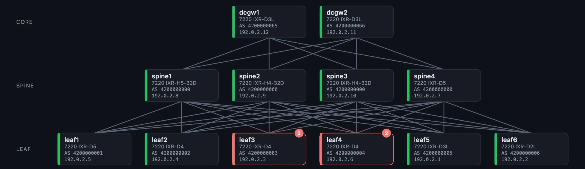
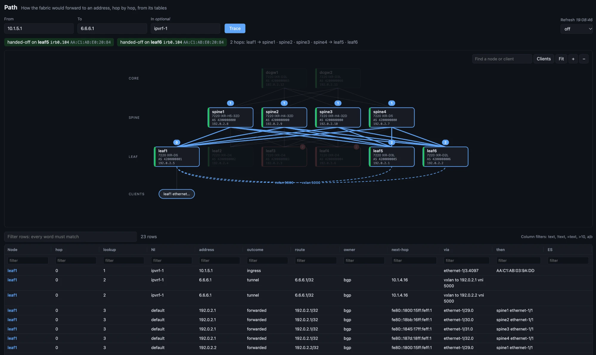
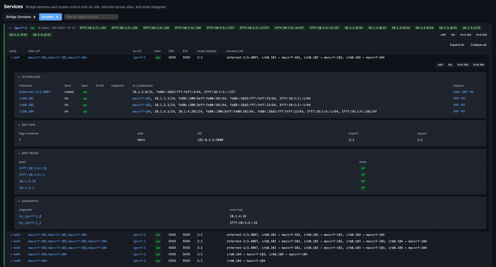

# fcling

[](https://github.com/srl-labs/fcling/actions/workflows/ci.yml)
[](https://pypi.org/project/fcling/)

What an SR Linux fabric looks like, what is wrong with it, and what changed, straight from gNMI.



This replaces [fcli](https://github.com/srl-labs/fcli), rewritten from the ground up. It runs on asyncio throughout, uses no Nornir and makes no blocking gNMI calls. On top of fcli's reports, it adds a streaming engine with history, fabric checks grouped into incidents, fabric-wide lenses, a web UI, and an MCP server and agent.

It needs Python 3.11 or later, and gNMI enabled on the nodes. It is tested against [SR Linux 25.3 to 26.7](#sr-linux-releases).

Install the `fcling` command once, then run it from anywhere:

```bash
uv tool install fcling          # or `pipx install fcling`; `uv tool install .` from a checkout
```

Or run it with Docker, without installing anything:

```bash
docker run --rm --network host -v "$PWD:/work" ghcr.io/srl-labs/fcling -t lab.clab.yml bgp-peers
```

Then:

```bash
fcling -t lab.clab.yml bgp-peers
fcling -t lab.clab.yml -i role=leaf -o json subif -f oper=down
fcling -c inventory.yml sys-info
fcling -t lab.clab.yml ipv4-rib -a 10.1.3.99          # longest-prefix match
fcling -t lab.clab.yml bgp-rib -r evpn -t 5 -d        # with the detail columns
fcling -t lab.clab.yml ifstats -s 2 -f oper=up        # rates over 2 s
```

With the engine running, the same commands answer instantly from what it streams, and can look back:

```bash
fcling -t lab.clab.yml serve                          # streams every node, keeps history
export FCLI_SERVER=http://127.0.0.1:8765
fcling bgp-peers                                      # live, from the engine
fcling bgp-peers --at 14:02                           # as it was then
fcling history --since 1h -r bgp-peers --follow       # what changed, which commit did it, and keeps watching
```

`fcling serve` also serves a web UI at <http://127.0.0.1:8765/>: the topology, incidents, history, lenses, every report and the agent, in a browser.

What is wrong, and what changed:

```bash
fcling checks                          # every finding, check by check
fcling incidents -v                    # grouped by root cause, worst first
fcling incidents --at 14:02            # what was wrong then
fcling baseline pre-change -m "before the MTU change"
fcling drift pre-change                # what came, went and changed since
fcling config-diff leaf1 12             # what commit 12 did to leaf1's configuration, side by side
```

Ask, or let your own AI client ask. Both get the same 14 read-only tools: status, reports, incidents, checks, history, configuration diffs, drift, baselines, the lenses and the topology.

```bash
export ANTHROPIC_API_KEY=...                                     # or OPENAI_API_KEY, XAI_API_KEY: for `fcling serve` too, to use Ask in the UI
fcling ask "what is wrong, and what changed just before?"        # the first provider with a key
fcling ask --provider openai --effort low "is BGP healthy?"
claude mcp add --transport http fcling http://127.0.0.1:8765/mcp        # MCP over HTTP from `fcling serve`
claude mcp add fcling -- fcling --server http://127.0.0.1:8765 mcp        # or over stdio
```

Questions across the whole fabric, and its shape:

```bash
fcling -t lab.clab.yml where 10.1.3.13                        # every place that knows an IP or MAC
fcling -t lab.clab.yml path leaf1 10.1.3.13 --ni ipvrf-1      # hop by hop, over ECMP and VXLAN
fcling -t lab.clab.yml service macvrf-102                     # one service on every node, and what disagrees
fcling -t lab.clab.yml endpoints                              # every attached host
fcling -t lab.clab.yml topology                               # tiers, cables, clients, segments
```

`path` in the web UI: the trace drawn on the topology, over ECMP and the VXLAN tunnels, with every lookup in the table below it.



A router end to end: its interfaces, BGP VPN, peers and segments on each node, with links to the ARP, ND and RIB reports.



`checks` and `incidents` work without a server too: one-shot from the nodes, or from the local history with `--at`. They exit 1 when there is an error, so they can gate a pipeline.

Reports: `sys-info`, `config-commits`, `lldp`, `subif`, `lag`, `ifstats`, `ni`, `bgp-peers`, `bgp-rib`, `ipv4-rib`, `ipv6-rib`, `tunnel-table`, `static-routes`, `routing-pol`, `mac`, `arp`, `nd`, `irb`, `es`, `es-dest`, `vxlan`, `bfd`, `isis`, `ospf`, `resources`, `components`, `transceivers`, `services`, `bridge-domains`, `routers`. Each is a pure function from gNMI paths to typed records.

## SR Linux releases

Each release below is tested on every change by replaying real gNMI recordings, so the tests need no lab. CI runs 25.10, 26.3 and 26.7 as a job each.

| SR Linux | Rows match the original fcli | fcling's own reads and subscriptions |
|---|---|---|
| 25.3 | 25.3.2 (2 nodes) | - |
| 25.10 | 25.10.3 (2 nodes) | 25.10.4 (3 nodes), 25.10.5 (1 node) |
| 26.3 | 26.3.1 (4 nodes) | 26.3.1 (2 nodes) |
| 26.7 | 26.7.1 (2 nodes), 26.7.2 (2 nodes) | 26.7.2 (2 nodes) |

The first column replays the Gets the original fcli made, and requires the same rows it rendered. The second is fcling's own exchange with a live node: which paths a release refuses, which reads come back empty, whether the subscriptions sync, and which fields stop being filled from one release to the next. Layouts before 24.10 are not supported. [MATRIX.md](tests/fixtures/releases/MATRIX.md) has what each lab covers, what differs between releases, and how to record a new one.

## Documentation

| | |
|---|---|
| [Installation and inventory](docs/installation.md) | installing, containerlab and static inventories, selecting nodes, TLS |
| [Reports](docs/cli.md) | every report, filters, output formats |
| [The web UI](docs/ui.md) | topology, incidents, history, lenses, reports and the agent in a browser |
| [The engine](docs/server.md) | `fcling serve`: how it streams, the HTTP API and its events, security |
| [History](docs/history.md) | what is kept, `--at`, commit attribution, baselines and drift |
| [Lenses and topology](docs/lenses.md) | `where`, `path`, `service`, `endpoints`, `topology`, adding a lens |
| [Checks and incidents](docs/checks.md) | every check, and how findings are grouped by root cause |
| [MCP and the agent](docs/ai.md) | the tools, MCP setup, `fcling ask`, and the variables for Claude, OpenAI and Grok |
| [Architecture](docs/architecture.md) | how it fits together, adding a report or a check, the tests |

## How it works

```
inventory ──► collect (one-shot) ──┐
          └─► engine (streaming) ──┼──► Tree per node ──► reports ──► records ──► render / API / tools
                                   │                         ▲
            history (SQLite) ◄─────┘   checks over all nodes ┘──► findings ──► incidents
```

- **A report never does I/O.** It declares the gNMI paths it reads and builds typed records from a tree. The same definition runs one-shot (a Get per datatype, every node at once), streamed (Subscribe in `fcling serve`) and on recordings in the tests.
- **Records are flat, frozen pydantic models.** One record is one row. It gives the JSON output, the schema that MCP clients and the API publish, and the key that history and drift compare by.
- **Every surface goes through one Service and one tool layer.** The CLI, the HTTP API, the web UI, MCP and the agent all see the same fabric.

[docs/architecture.md](docs/architecture.md) has the module map, and covers adding a report or a check.

## Development

```bash
make test lint          # pytest, then ruff and mypy
make proto              # regenerate the gNMI stubs (they are committed)
```

No lab is needed. [tests/fixtures/releases](tests/fixtures/releases/) holds real gNMI recordings from SR Linux 25.3 to 26.7, made with the original fcli. [test_release_matrix.py](tests/test_release_matrix.py) replays them through the new reports and requires the same rows the original rendered. [tests/fixtures/reads](tests/fixtures/reads/) holds fcling's own recordings, which [test_release_reads.py](tests/test_release_reads.py) checks release by release. [fake_gnmi.py](tests/fake_gnmi.py) is an in-process gNMI target that the client, TLS, the collector, the engine, the server and the CLI are tested against. [MATRIX.md](tests/fixtures/releases/MATRIX.md) explains what each set of recordings checks.

## License

BSD-3-Clause, see [LICENSE](LICENSE).
